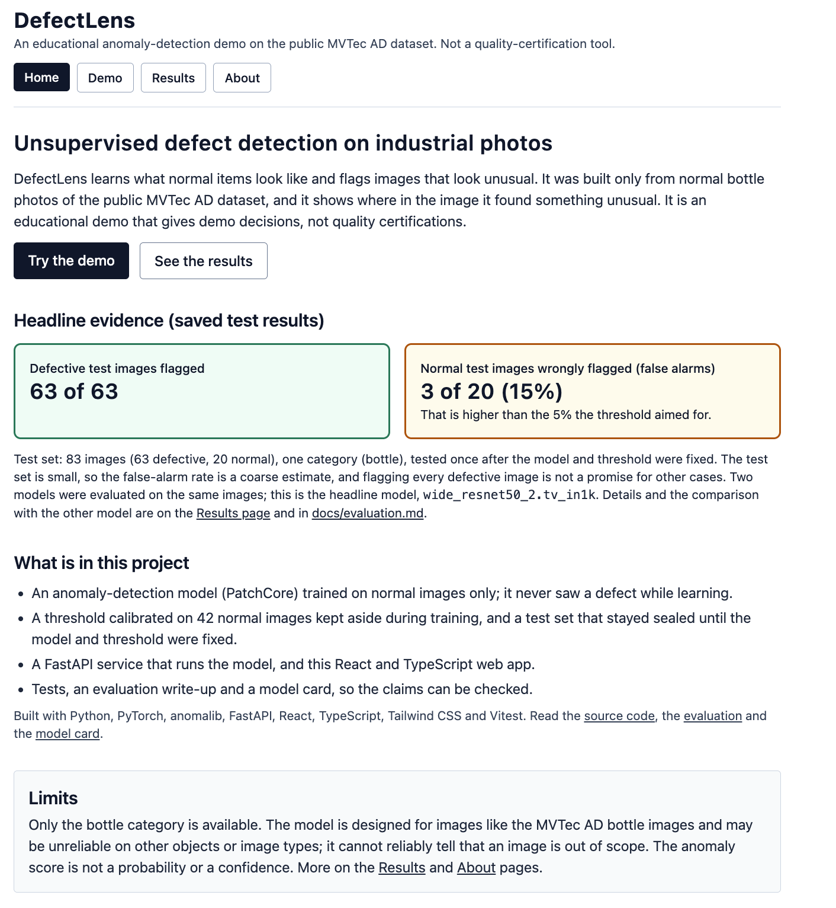
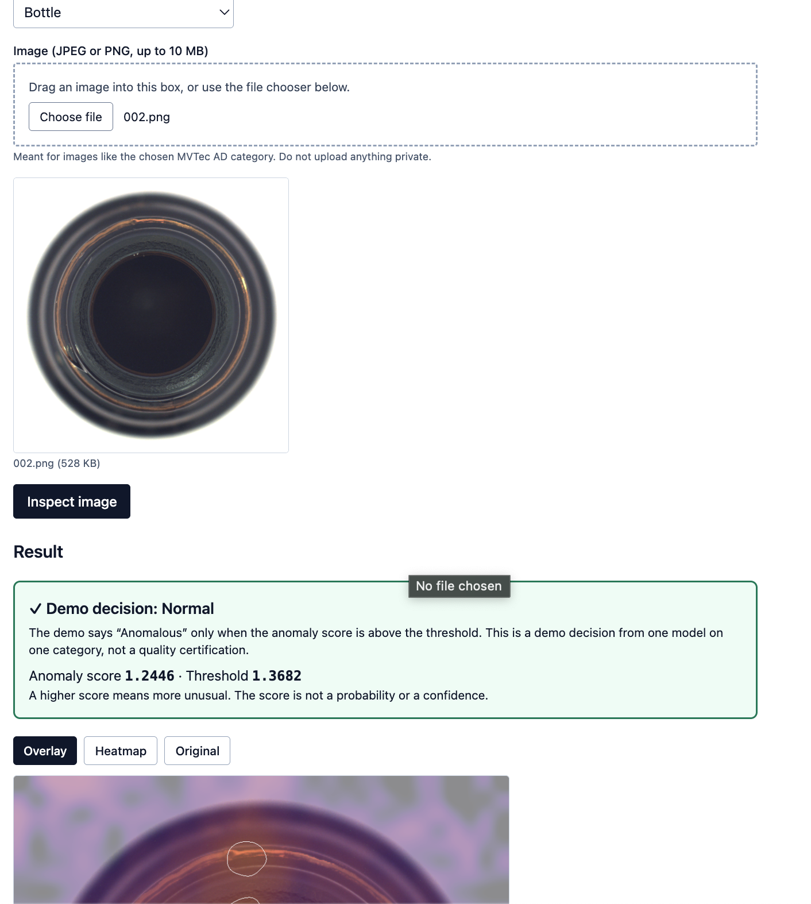
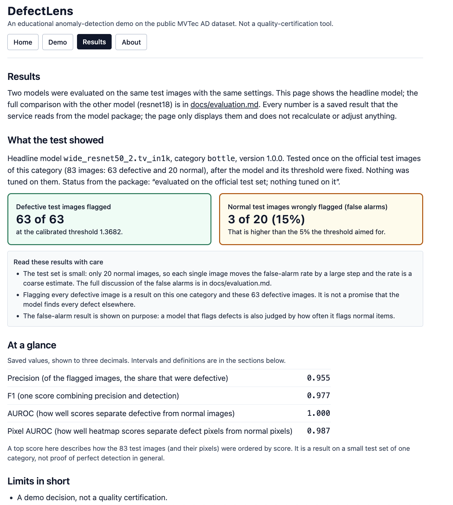

# DefectLens — Industrial Anomaly Inspection Demo

A portfolio project that demonstrates **visual anomaly detection** on industrial products. A user picks a product category, uploads an image, and the app reports whether it looks **normal** or **anomalous**, with the anomaly score, the threshold, and a heatmap of where the image differs from normal.

The model is **PatchCore** (PyTorch, via the anomalib library), fitted only on defect-free images from the **MVTec AD** dataset. It never needs examples of defects.

> **Status: local portfolio project.** Release 1 (one category, `bottle`) runs locally: two PatchCore models are fitted, calibrated and evaluated once on the sealed test set (results in [docs/evaluation.md](docs/evaluation.md)), with a local API and web app. There is no hosted demo (see "Demo status" below). See [SCOPE.md](SCOPE.md) for what is in scope and what is deferred, and [decisions.md](decisions.md) for the running log of decisions and progress.

> **Educational demo.** This is not a certified quality-control or inspection system. Results are only meaningful for supported categories photographed like the MVTec AD images, and the anomaly score is not a probability or a confidence.

## Demo status

There is **no hosted live demo** in this portfolio version. Hosting the model needs more memory than any free option reviewed reliably offers, and paid hosting was ruled out, so hosted deployment is **deferred, not done**. The app runs locally (see below). Evidence that it works (see [docs/local-walkthrough.md](docs/local-walkthrough.md)): the saved evaluation on the MVTec `bottle` test set ([docs/evaluation.md](docs/evaluation.md), the only evidence about detection accuracy), local run instructions, and screenshots of the local app (these show the workflow, not accuracy; no recording exists). See [docs/deployment-readiness.md](docs/deployment-readiness.md). Scope of this version: a focused local `bottle` demo; only `bottle` was evaluated, and later roadmap phases (hosting, more categories, saved history, PDF reports, production hardening, extra model studies) are deferred, not done (see [SCOPE.md](SCOPE.md)).

## Screenshots of the local app

These show the workflow of the local web app. They are **not evidence of detection accuracy**; that evidence is the saved test-set evaluation in [docs/evaluation.md](docs/evaluation.md).





*Demo page. The image is a **calibration example** (an MVTec AD training image, adapted by the app's overlay), used only to show the workflow, not detection accuracy. Dataset: MVTec AD, © MVTec Software GmbH, CC BY-NC-SA 4.0; this project is not endorsed by MVTec (see [docs/data.md](docs/data.md) and [DATA_LICENSE.md](DATA_LICENSE.md)).*



More screenshots (`b.png` empty Demo, `d.png` overlay and footer, `f.png` About) are in [screenshots/](screenshots/). See [docs/local-walkthrough.md](docs/local-walkthrough.md).

## What exists so far

- A Python workspace (`core/`) with PatchCore compatibility tests.
- Ruff (lint and format) and pytest, run automatically on GitHub Actions (`.github/workflows/ci.yml`).
- A second CI job for the frontend (format check, lint, type-check, tests, build) in the same workflow.
- Experiments on saving and reloading a PatchCore model (`scripts/feasibility/`), using synthetic data only.
- A script that checks a local copy of the MVTec AD dataset (`scripts/data/verify_dataset.py`). The dataset itself is not part of this repository.
- A fixed 80/20 split of the `bottle` training images into a "fit" group and a "calibration" group (`scripts/data/make_splits.py`, `splits/bottle.json`). It lists file names only.
- A train-only look at those images (`scripts/data/eda_train.py`): simple brightness, colour and sharpness numbers, comparing the fit and calibration groups (a rough check, not a proof). It reads training images only.
- Shared image preprocessing (`core/src/defect_core/preprocessing.py`) with tests on synthetic images. The PatchCore wrapper (`model.py`: build, fit, score) with tests on random data.
- A second Python package, `ml/` (`defect_ml`): the single guard that lets data tools open only training images, the split rules, and a loader for the `fit` and `calib` images that checks every file against the verified manifest (`scripts/data/check_loader.py` checks it on the real `bottle` training images).
- A fit program (`defect_ml/fit.py`, settings in `ml/configs/`) and the first two real fits on the `bottle` `fit` images; the weights are pinned by tag and recorded with their hashes (`docs/data.md`). The sealed test evaluation (`defect_ml/evaluate.py`) has been run once for `bottle`; results are in `evaluation/` (decisions.md entries 065–066: image AUROC 1.00 for both models, but false alarms on normal test images above the 5% target; example figures in `evaluation/*/v1.0.0/bottle/figures/`). Both fitted models have been frozen and calibrated on the 42 held-out `calib` images (`defect_ml/freeze.py`, `defect_ml/calibrate.py`; `decisions.md` entry 061). The test set is still unopened and no detection quality has been measured.
- A serving-style benchmark (`defect_ml/benchmark.py`) of the fitted models: native macOS proxy measurements only; the container measurements are still open.
- Rendering of results (`render.py`: fixed-scale inferno heatmap, overlay with outline, largest highlighted region, area fraction), tested with synthetic arrays.
- The calibration arithmetic (`calibration.py`: conformal threshold, strict verdict rule, normal rank, heatmap levels), tested with synthetic numbers.
- A resource measurement of fitting and scoring on this Mac with random data (`scripts/feasibility/f1_resources.py`).
- Saving and loading a fitted model (`artifacts.py`: safetensors weights plus a checked `manifest.json`), tested with random data.
- Freezing, calibrating and packaging of the two `bottle` models (`defect_ml/freeze.py`, `calibrate.py`, `package.py`): each package is a model file plus a checked manifest and a `NOTICE.md` with the dataset terms. Nothing has been uploaded anywhere yet.
- `make` targets that run the model pipeline in order (`fit`, `freeze`, `calibrate`, `evaluate`, `figures`, `package`, `infer`; see [docs/evaluation.md](docs/evaluation.md) §8). The two that open the sealed test set refuse to run without an explicit confirmation flag.
- A local API (`backend/`, FastAPI): health and readiness, categories, model description, evaluation, and a stateless `POST /api/v1/inspections` that uses the same inference function as the command line; settings are documented in `.env.example`. Not deployed, no Docker image yet.
- A local inference command (`python -m defect_core.infer`, see below) that verifies a package and inspects one image.
- Data notes and licensing: [docs/data.md](docs/data.md) and [DATA_LICENSE.md](DATA_LICENSE.md).

- A local web app (`frontend/`, React): Home, Demo, Results and About pages that call the local API (see "Run the web app locally"). No hosted demo.
- A short guide to running and showing it locally: [docs/local-walkthrough.md](docs/local-walkthrough.md).

The roadmap is private for now.

## Set up and check

Requires [uv](https://docs.astral.sh/uv/) and `make`. The environment was set up on an Apple M1 Mac with 8 GB of memory; see [docs/dev-environment.md](docs/dev-environment.md).

```
make setup    # install dependencies (Python 3.12, PyTorch, anomalib) into .venv
make lint     # style and mistake checks
make test     # run the tests (about 10 seconds)
```

On Linux, a GitHub Actions run (Ubuntu, x86_64, 2026-11-09, commit `90624b0`) installed the locked dependencies and passed lint and tests. For Linux, `uv.lock` lists the large GPU-enabled PyTorch build; a CPU-only setup has not been configured yet.

## Run inference locally

Needs a model package folder (the files are not in this repository; they are made by the fit, freeze,
calibrate and package steps in [docs/evaluation.md](docs/evaluation.md) §8; a private Hugging Face
repository was chosen as the future store ([ADR-0003](docs/adr/ADR-0003-artifact-store.md)), but it has not been
created and **nothing has been uploaded**) and an image of your own:

```
uv run python -m defect_core.infer --artifact artifacts/bottle_wide_resnet50_2_tv_in1k_v1.0.0_release path/to/image.png
uv run python -m defect_core.infer --artifact <package folder> image.png --out results/   # also save images
uv run python -m defect_core.infer --artifact <package folder> image.png --json           # machine-readable
```

It first verifies the package (file hashes, tensor shapes, the stored calibration and the notice);
a damaged or edited package stops with a plain message and nothing is scored. It then prints a
**demo decision** ("Normal" or "Anomalous": the score is above the stored threshold or not), the
score, the threshold, the decision rule, and the **rank** ("score higher than *m* of the *n*
calibration normal images": a rank, not a probability or a confidence), plus how much of the image
lies above the highlight level. With `--out DIR` it saves `<name>_heatmap.png` (fixed-scale
heatmap) and `<name>_overlay.png` (heatmap over the image with the outline), both at the original
image size; it never overwrites an existing file. It needs no network and no dataset.

The model only makes sense for images like the category it was fitted on (MVTec AD `bottle`: a
bottle seen from above, centred, controlled lighting) and **cannot reliably tell that an image is out
of scope**: a photo of something else will usually be called "Anomalous" with a high score. This is
an educational demo, not a quality-control system.

## Model package store (planned, not uploaded)

The model packages are not in git. They are planned to live in a **private Hugging Face model repository**
([ADR-0003](docs/adr/ADR-0003-artifact-store.md)); **nothing has been created or uploaded**, and whether
uploading the weights is permitted is **unverified**. [`artifacts.lock.json`](artifacts.lock.json) lists
every file's size and SHA-256. `make store-plan` shows what an upload would send (no network, no token).
`make store-download` (after an upload, with a read-only token in `DEFECTLENS_HF_READ_TOKEN`) downloads the
pinned commit, refuses anything that differs from the lock, and loads each package. Tokens are never
stored in the repository.

## Run the API locally

```
export MODEL_DIR=artifacts/bottle_wide_resnet50_2_tv_in1k_v1.0.0_release   # a model package (see above)
uv run uvicorn --factory app.main:create_app --app-dir backend --port 8000 --no-access-log
# interactive documentation: http://127.0.0.1:8000/docs
curl -F category=bottle -F file=@image.png http://127.0.0.1:8000/api/v1/inspections
```

The service starts at once and answers `/api/v1/health`; `/api/v1/ready` says 503 until the package
has been verified and warmed up (and stays 503 with `"failed"` if it cannot be served; the reason is
in the log). Settings are environment variables, listed with their defaults in
[.env.example](.env.example); a bad value stops the start-up with a clear message. Uploads must be
JPEG or PNG (checked by their bytes, not their name), at most 10 MB, each side 64 to 8000 pixels. Errors
use one envelope, `{"error": {"code", "message", "details", "request_id"}}`. The result is a demo
decision with the same fields as the command line (score, threshold, rank, heatmap and overlay as
PNG data URLs); nothing is stored. Only one inspection runs at a time; others wait up to
`INFERENCE_QUEUE_TIMEOUT_S` and then get 503 `BUSY`. Inspections are rate-limited per client
(`RATE_LIMIT`); behind a proxy set `TRUSTED_PROXY_HOPS` (see `.env.example`; the right value for
Render is **unverified**). This is a local development setup: not deployed, no container image yet.

## Run the web app locally

The web app (`frontend/`) is a static single-page app: it runs in the browser, holds no model and talks
to the API above. It needs Node 22.12 or newer (tested here with 22.16.0) and about 0.2 GB of disk for
its packages. Use two terminals:

```
# terminal 1: the API (see above), allowing the web app's address
export MODEL_DIR=artifacts/bottle_wide_resnet50_2_tv_in1k_v1.0.0_release
export ALLOWED_ORIGINS=http://localhost:5173
uv run uvicorn --factory app.main:create_app --app-dir backend --port 8000 --no-access-log

# terminal 2: the web app
make frontend-install          # npm ci: installs exactly what package-lock.json says
cd frontend && npm run dev     # http://localhost:5173
```

Choose a category, choose a JPEG or PNG image and press "Inspect image". The result shows the demo
decision, the anomaly score next to the threshold, the comparison with the 42 normal calibration images,
the highlighted area, and the original, heatmap and overlay images. Each number has a plain-language
explanation beside it (higher score means more unusual and is not a probability; the threshold is a
cutoff above which the demo says "Anomalous"; the comparison is not confidence; the highlighted area is a
display aid, not a defect size) and a "How to read these results" section.

**Page check with one real normal image (not a performance test):** after starting both programs, choose
`data/raw/mvtec-ad/bottle/train/good/002.png`, a file listed under `calib` in `splits/bottle.json`. It is a
training-split image, and its score is one of those used to set the threshold, so it checks that the
page works and the numbers look plausible. It says nothing about model performance: that evidence is the
formal test-set evaluation in [docs/evaluation.md](docs/evaluation.md). The API address is `VITE_API_BASE_URL` (default
`http://localhost:8000`; see [frontend/.env.example](frontend/.env.example)). Checks: `make frontend-check`
(format, lint, type-check, tests, build). The TypeScript types are generated from the API's OpenAPI
description: after changing an endpoint run `make api-contract`; a backend test fails if the committed
`frontend/openapi.json` is out of date. What exists so far (Phase 6): four pages with a navigation bar (Home, Demo, Results, About). They are written for a quick reader: the key evidence and the key caveats are always visible, and the supporting detail is in expandable sections (nothing was deleted). **Home** (`/`) is a one-screen summary with a "Try the demo" button, the headline evidence (**63 of 63** defective test images flagged, **3 of 20 (15%)** normal images falsely flagged, the small-test-set caveat, and that two models were evaluated) and links to the source code, `docs/evaluation.md` and the model card. It makes no API calls: its numbers come from `frontend/src/generated/evidence.json`, a snapshot of the saved `metrics.json` made by `make evidence` (and a test fails if the snapshot is stale). **Demo** (`/inspect`) is the page described above: the result card shows the demo decision, the score next to the threshold and the image in tabs (Overlay selected first, then Heatmap and Original); the explanations are under "Show details" and "How to read these results". **Results** (`/model`) leads with the same two headline cards, a four-value at-a-glance table and the limits in short, then expandable sections for the counts, scores with intervals, per-defect-type counts, pixel-level results, the threshold, model details and all limitations (see below). **About** (`/about`) keeps the dataset attribution and the CC BY-NC-SA 4.0 licence visible and puts citations, the code-licence status, privacy, the unconfirmed items and the disclaimers in expandable sections, taken from [DATA_LICENSE.md](DATA_LICENSE.md), [docs/data.md](docs/data.md) and [docs/model-card.md](docs/model-card.md). The footer has a source-code link (`VITE_SOURCE_URL`).

The **Results page** reads `GET /api/v1/model` and `/api/v1/metrics/bottle`, which serve the results stored in the model package, and only displays them: nothing is recalculated. It states that both models were evaluated and links to [docs/evaluation.md](docs/evaluation.md) (set `VITE_DOCS_BASE_URL` to point the link elsewhere) for the comparison with `resnet18`. No charts or dataset figures yet. Three checks keep the numbers honest: a frontend test feeds the real `evaluation/wide_resnet50_2_tv_in1k/v1.0.0/bottle/metrics.json` through the page and compares every number shown, and also fails on any number that did not come from the data; `scripts/tests/test_evaluation_matches_package.py` checks the saved metrics are consistent and (when the package is on the machine) equal the package's copy and hashes; the service itself refuses evaluation files whose hash does not match the package. The **Demo page** has a drop zone: a dashed box around the real file input, which stays visible and reachable with Tab. Dropped and picked files go through the same checks (`checkFile`), and only the first of several dropped files is used. The box itself is not a control; the keyboard route is the file input. The sample gallery is not built, and no dataset image is included in the web app. The code-based keyboard and layout pass is described in the checklist below. Not deployed. Opening `/about` or `/inspect` directly works on the dev server; a static host will need a rewrite of every path to `index.html` (a Phase 7 task).

## Project documents

- [SCOPE.md](SCOPE.md): what the project is and is not.
- [decisions.md](decisions.md): dated log of decisions and actions.
- [docs/dev-environment.md](docs/dev-environment.md): machine, tools, and library versions.
- [docs/adr/ADR-0002-model-and-serving.md](docs/adr/ADR-0002-model-and-serving.md): Checkpoint A, the rule that names the headline model and the frozen calibration settings.
- [docs/adr/ADR-0003-artifact-store.md](docs/adr/ADR-0003-artifact-store.md): where the model packages are planned to be stored (a private Hugging Face repository; nothing is uploaded yet; licence status unverified).
- [docs/data.md](docs/data.md): the dataset, its layout, citation, and what has been checked.
- [evaluation/NOTICE.md](evaluation/NOTICE.md): dataset attribution and license terms for the figures (adapted MVTec AD images).
- [docs/evaluation.md](docs/evaluation.md): how the models were evaluated and what the saved results show, including the false alarms and the limits.
- [docs/model-card.md](docs/model-card.md): short model card (intended use, limits, results).
- [DATA_LICENSE.md](DATA_LICENSE.md): dataset license and attribution, and what is and is not redistributed.
- [docs/licensing-review.md](docs/licensing-review.md): read-only review of the open licence and publication questions (sources read, what is unverified, options; no decision made).
- [docs/local-walkthrough.md](docs/local-walkthrough.md): short guide to running the app locally and to recording or screenshotting it (calibration example only; shows the workflow, not accuracy).
- [docs/deployment-readiness.md](docs/deployment-readiness.md): review of Docker, CPU-only torch and Render (official pages read 2026-11-11; what is unverified; options that depend on MVTec's reply or the artifact-store decision). Nothing is built or deployed.

## Dataset and attribution

The models are fitted on the **MVTec Anomaly Detection (MVTec AD)** dataset, released by MVTec under the **CC BY-NC-SA 4.0** license, which prohibits commercial use. This project is a non-commercial educational demo. The local copy used for development is not included in this repository; it was downloaded from Kaggle, and it has not been compared file by file with the official MVTec archive (only the per-category image counts match the official paper). Attribution, the citation, and notes on processed images are in [DATA_LICENSE.md](DATA_LICENSE.md) and [docs/data.md](docs/data.md); both the CVPR 2019 and IJCV 2021 citations are included. Official page: <https://www.mvtec.com/research-teaching/datasets/mvtec-ad>.

## License

This repository is public and the project is noncommercial. **The project code currently has no licence granting reuse rights**: no `LICENSE` file exists, and none is planned. The repository being public and viewable does not mean a general licence is granted to copy, modify or redistribute the code. This does not change the terms for the MVTec data, the figures or the model weights, which are described separately above and in [DATA_LICENSE.md](DATA_LICENSE.md).

### Manual browser checklist (a browser check was done; details not recorded)
Automated tests cannot open the operating system's file chooser, draw the focus ring, or show layouts. The app has been checked in a real browser, but which of the items below were covered, and the results, were **not recorded**, so the items are not marked individually. Colour contrast, other browsers, phones and screen readers are **not verified**. To repeat the check, use a real browser (start both servers as above):

1. **Widths:** in the browser's device mode, look at Home, Demo, Results and About at 360, 768 and 1280 px wide. Look for sideways scrolling, text running off the screen (the DOI link on About, the tables on Results), overlapping items and buttons that are hard to tap.
2. **Keyboard only (no mouse):** press Tab from the top of each page. The first stop is "Skip to the main content", then Home, Demo, Results, About. Every stop shows a visible focus ring, and the order follows the page.
3. **Demo file input:** Tab to the file input; it must show a visible focus ring. With it focused, press Enter or Space: the file chooser should open. Choose a JPEG or PNG; the preview appears and "Inspect image" turns on. Then Tab to the button and press Enter.
4. **Drop zone:** drag a JPEG or PNG onto the dashed box (the hint text changes while you drag). Drag a text file onto it: the same "Choose a JPEG or PNG image" message appears as when you pick one. Drop two files: a note says only the first is used.
5. **Expandable sections:** on Results and About, focus a section title and press Enter or Space to open and close it.
6. **Tabs:** after an inspection, Tab to the tab list and use the arrow keys, Home and End.
7. **Contrast and zoom:** zoom to 200%; check that text stays readable and nothing is cut off. Colour contrast has not been measured (the tests cannot compute it).
8. **Screen reader (optional):** with VoiceOver, check that the file input is announced with its label and hint.
Use only a synthetic or your own image; do not use dataset images.
